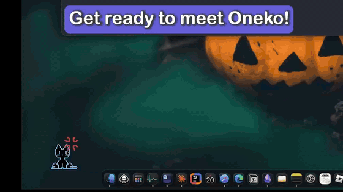

# Oneko for macOS



▶️ [Watch the demo with sound](docs/8mb.video-wi7-2DdRmmdF.mp4)

The classic Neko desktop cat, as a native menu bar app. It chases your cursor across every display and Space. When it's left alone it scratches, yawns and falls asleep.

## Install

**Download:** grab `Oneko-<version>.dmg` from the [latest release](https://github.com/rsinghSD/oneko/releases/latest), open it, and drag **Oneko** to **Applications**.

**Homebrew:**

```bash
brew tap rsinghSD/oneko https://github.com/rsinghSD/oneko
brew install --cask oneko
```

Oneko runs on macOS 13 or later, on Apple silicon and Intel. It isn't notarized by Apple yet, so the first time, right-click **Oneko** in Applications and choose **Open**. Or run `xattr -dr com.apple.quarantine /Applications/Oneko.app`.

## Build from source

```bash
./build.sh --run       # build and launch
./build.sh --install   # build, copy to /Applications, launch
./build.sh --dmg       # universal build + build/Oneko-<version>.dmg + Casks/oneko.rb
```

It's a Swift package (one target, no dependencies), and `build.sh` compiles it with `swiftc` directly; no Xcode project is needed. `./make-demo.sh` re-renders the demo video from the real engine (needs ffmpeg). `build/Oneko.app/Contents/MacOS/Oneko --selftest` runs the headless self-tests, `--bench` times the simulation (see [docs/performance.md](docs/performance.md)), and `--diagnose` prints what Oneko sees of your displays and the Dock (handy for bug reports). To see why physics is running, launch it with `ONEKO_DEBUG=1`.

## Playing with the cat

- **Pet:** click the cat and a heart pops up. Petting also calms an angry cat.
New here? **How to Play…** in the menu (shown once on first launch) sums it all up.

- **Stay:** double-click and it sits down and sleeps where it is. Double-click any sleeping cat (staying, parked or off napping) to wake it, and it chases you again. Hover over a sleeping cat and it tells you so.
- **Drag & yeet:** grab the cat and it hangs off your cursor. It turns with your hand like a Wii remote: circle the mouse and it spins around the cursor in step, hold still and it hangs upright. Let go and it flies off with your throw speed and its spin. It tumbles, bounces off screen edges, and lands on the Dock or on top of a window. Throw it hard and it gets a 💢.
- **Window juggling:** drag a window into the cat and it gets knocked flying (💢). If the cat is sitting on a window, flick the window up to launch it. Swing a window into a flying cat to bat it, or slide one gently under it to catch it on the title bar, then launch it again.
- **Fetch:** turn on **Bone** in the menu, then throw the bone or click it for a little toss. A held bone twirls with your hand, just like the cat. The cat runs after it, catches it in mid-air if it can, and carries it back to your cursor.
- **Cardboard boxes:** turn on **Cardboard Box** and drag it anywhere. The cats can't resist napping in it, and you can drop or throw a cat straight in. You can even hold the box and catch a thrown cat in it, then carry the cat around. **Right-click** the box to close the flaps. A cat inside stays put (and rattles the box when it wants out), and opening it lets the cat pop out. Set how many boxes under **Settings ▸ Toys**, from 1 up to **1,000,000**. Every cat uses every box (one cat per box). The first 50 are real boxes; the rest pile up in the bottom-right corner of each display, drawn once by the graphics chip, so even a million cost almost nothing. You can't pick those up, but cats still curl up in the ones near the top.
- **Every toy, every cat (0.6.0):** the closest cat fetches a thrown bone (a closer one takes over on the way, and it brings it back to *you*), any cat chases a rolling ball of yarn, and with the laser on the whole gang piles onto the dot. Up to 50 bones and 50 balls of yarn (**Settings ▸ Toys**).
- **Food bowls:** cats get hungry every 20–40 minutes, walk to the nearest bowl and eat (sometimes followed by a nap). Click a bowl to fill it up.
- **Playing together:** cats sitting next to each other now and then groom each other (hearts), have a play-fight (💢) or chase each other. Turn it off under **Settings ▸ Cats**.
- **The big box:** make the first box a big one and four cats fit in it. They nap there until you take them out: drag a cat out by its head, or double-click it awake. Drag the box itself to carry them all.
- **Stacking:** drop a box on a box and it stacks; pull out the bottom one and the stack falls. In Toolbox mode cats hop up onto boxes to get to you. Crowd cats nap in the GPU box heap.
- **Names and stats:** hover over any cat for its name and its own stats; **Settings ▸ Stats** has the top cats. ⌥-click any cat to rename it (the first cat can also be renamed under **Settings ▸ General**).
- **Weather:** your real weather falls from the top of the screen: rain, a thunderstorm with lightning, snow, or glints of sunshine on a clear day. Oneko finds your rough location from your IP address (ipwho.is, no permission needed) and asks Open-Meteo for the weather there every 30 minutes. Or pick seasonal (snow in winter, leaves in autumn) or any weather yourself in **Settings ▸ General ▸ Weather**. Drawn by the window server, so it costs Oneko almost nothing.
- **Updates:** Oneko asks GitHub for the newest release once a day (turn it off in **Settings ▸ General**), or choose **Check for Updates…** in the menu.
- **Clip it:** right-click the cat to clip it in mid-air with a little clothespin, even mid-throw. Right-click while dragging the cat, the box or the bone to clip it where you're holding it. Right-click a clipped thing to let it drop. (Right-click on a box that isn't clipped or being dragged still opens and closes it.)
- **Park it:** drop or throw the cat onto the Dock or onto a window (it rides along), or drop it gently into the menu bar (1× size only, since bigger cats don't fit), and it parks there. It sits, dozes off and doesn't move until you pick it up or double-click it.
- **The real Dock:** Oneko uses the Dock itself, not the whole strip along the bottom of the screen. Things land on top of the Dock, and beside it they fall all the way to the bottom. It works out the Dock's length from its icons; allow Accessibility under **Settings ▸ Behavior ▸ Dock size** and it reads the exact size instead.
- **The Dock is not a floor:** if you lead the cat into a showing Dock with your cursor, it gets yeeted up and over, and lands on top of the Dock. Just dipping its feet in only nudges it back on top. If your Dock hides automatically, it **bonks** whatever's sitting where it pops up (cats and toys) into the air; turn that off under **Settings ▸ Behavior ▸ Dock**, and the Dock just lifts them onto its top instead. After a yeet there are 3 seconds of grace, so it never loops. An auto-hiding Dock counts only while it's really showing (just as macOS does it: push the cursor against the bottom edge, and it shows until you move away), and anything sitting on top of it falls when it hides.
- **Nap spots:** when you leave it alone, the cat may wander off for a long nap on a window's title bar (riding along if you move the window, and falling off if you close it), in the menu bar, or on top of the Dock.

## More cats, toys, coats and hats

- **Settings ▸ Cats:** anywhere from 0 cats (just the toys) to 10,000 real cats: pet, drag, yeet and park each one. Each real cat is its own little window with its own physics, so past a few hundred your Mac will feel it (Oneko asks before spawning more than 1,000, and they arrive in batches). Extra cats can **swarm** around your cursor (the default), follow each other in a **conga line**, or **roam** free. Their coats can take turns, all match, be random, or be chosen one by one.
- **Crowd mode** (optional, off by default, the nuts.wad switch): cats past 50 become crowd cats, drawn by the graphics chip, and the count goes up to **1,000,000**. They're light on resources (20,000 of them use about 12% CPU), click-through, and can't be picked up. It gets choppy in the tens of thousands, and at a million the screen is solid cat.
- **Toys ▸ Ball of Yarn:** it rolls with real physics, and the cat bats it and chases it while it rolls. Throw it, or click it for a nudge.
- **Toys ▸ Laser Pointer:** a red dot follows your cursor, and the cat dashes after it and pounces.
- **Toys ▸ Give Catnip:** about 12 seconds of zoomies.
- **Coat ▸ Paint Your Coat…:** choose outline, fill and accent colours and a pattern (Tabby, Spots, Patches, Tuxedo, Socks) with a live preview. It's saved as **My Coat**.
- **Hat:** **Seasonal** gives a witch hat from 15 to 31 October, a Santa hat in December and a party hat around New Year. Or pick one yourself, or none. Hats tilt and spin with the cat.
- **Sounds** (off by default; turn them on under **Sounds ▸ Sounds On**, there's nothing to download): synthesised in code, with no audio files. A soft purr when you pet it, a mrrp on big yeets and box hops, a meow on waking, a thud on hard landings, and a sleepy yawn and sigh when it dozes off. There are three volume levels.
- **Reacts to Your Mac:** after 2 minutes without input, everyone naps where they are. When you're back, they stretch awake. From 11 pm to 6 am it's a bit slower and naps more.
- **Stats:** pets, yeets, highest yeet, fetches, window bonks, Dock yeets, box naps, yarn bats and Touch Bar trips. Reset them from the same menu.
- **Drop into the Touch Bar** (only on Macs with a Touch Bar): throw the cat down hard onto the bottom of the MacBook's own screen and it falls through into the Touch Bar. It has to be a real downward throw (not just letting go) that hits the floor at 1800 pt/s or more. Both trips can be switched off under **Neko Lives On** (**Slam Down Into Touch Bar**, **Flick Up To Desktop**).

## Touch Bar mode

On a Mac with a Touch Bar, choose **Neko Lives On › Touch Bar** in the menu. Neko then lives **only** on the Touch Bar: the desktop cat, toys and toolbox go away until you switch back to **Desktop**. A neko button in the Control Strip brings the bar back if you close it.

It's the same playground in a 30 pt strip, with gravity and a tall invisible sky above it:

- It trots along the bar to the spot under your cursor. **Tap** an empty part of the bar and it runs there instead.
- Extra cats come along too, up to 50 on the bar (it's about 33 cats wide, so past that they pile up). Each can be petted, flicked and clipped, and any of them can nap in the box or make the trip to the desktop.
- **Tap** the cat to pet it (hearts; calms a 💢). **Double-tap** to make it stay.
- **Flick it** to yeet it. The moment it rises even a little above the top of the bar, it leaves the Touch Bar: it flies up out of the bottom of the MacBook's screen, and Neko lives on the desktop again. It's the cat you flicked that flies up, and it works the other way too: slam any desktop cat down hard and that cat drops onto the bar.
- **Long-press** to clip it in place with the clothespin, and long-press again to let go.
- The **cardboard box** is always on the bar, and the **Bone** can be added from the menu. Anything that ends up past the visible ends of the bar is pulled back. Flick the bone and it fetches; long-press the box to open or close it. When it's idle near the box, the cat climbs in for a nap.

This uses private macOS APIs (DFRFoundation, the same ones Pock and MTMR use).

## Toolbox mode (V3)

Turn on **Toolbox (Paint tools)** in the menu. A dark macOS HUD toolbox appears on the left with all 16 classic Paint tools (as SF Symbols) and the 16-colour palette.

In Toolbox mode **Neko is ruled by gravity**. It can't float to your cursor any more. It walks along the ground, the top of the Dock, window tops and **whatever you draw** toward your cursor, and it idles underneath when it can't reach you. Draw it ramps and platforms. It walks up and down gentle slopes, steep lines are walls, and it falls off edges.

- **Pencil, Brush, Line, Curve, Rectangle, Polygon, Ellipse, Rounded Rectangle, Text:** everything you draw is solid ground. Drawing straight through the cat knocks it flying.
- **Eraser:** rubs out drawings (anything standing on them falls) and fades the cat. Fully erased, it reappears from the top of the screen.
- **Fill With Color:** paints the cat or fills a closed shape. **Pick Color** takes a colour from the cat or a drawing.
- **Magnifier:** makes the cat huge for 10 seconds (right-click turns it back).
- **Airbrush**, **Select / Free-Form Select** (grab the cat and move it), and **Clear**.
- Choose **Pointer** to pet, drag and throw as usual, and to click through to your apps.

## Performance

- **Idle (normal):** about 0.7% CPU and 14 MB of memory. Window positions are read once a second unless something is riding a window or flying, and nothing is redrawn while the cat sits still.
- **Full-screen apps:** when a full-screen app (a Space, a video or a game) covers the display with the cat or cursor, Neko curls up asleep. The app drops to one quiet tick a second, stops watching the mouse, and settles at about 0.1–0.2% CPU. It wakes as soon as you leave.
- **Toolbox drawings:** shape layers composited by the GPU, with no full-screen bitmaps. That saves roughly 80 MB per display compared with drawing into a bitmap.
- **GPU / WindowServer:** an on/off A/B test couldn't separate Oneko from normal desktop noise.

## Menu & Settings

The menu bar keeps the quick things: **Pause**, **Toys**, **Toolbox**, **Neko Lives On** (on Touch Bar Macs), **Settings…** (⌘,), **How to Play…**, **What's New…**, **About** and **Quit**. The first time you launch Oneko after an update, the **What's New** window lists what changed. Everything else is in **Settings**, with tabs for General, Behavior, Toys, Sounds, Touch Bar and Stats.

What each option does:


- **Pause / Resume** (⌘P): the cat curls up and sleeps where it is.
- **Speed**: Slow, Normal, Fast or Zoomies (48 pt per tick).
- **Size**: 1×, 2× or 3×. **Coat**: Classic, Midnight, Ginger, Gray, Cream, Sakura, Ghost, or your own 256×128 sprite sheet.
- **Cardboard Box**, **Bone**: toys. **Toolbox (Paint tools)**: see above.
- **Naps When Idle** and **Nap Spots** (window title bars, menu bar, Dock).
- **Hide in Full-Screen Apps**: the cat disappears from any display that the frontmost app fills edge to edge.
- **Neko Lives On › Desktop / Touch Bar** (only on Macs with a Touch Bar), and **Launch at Login**.

Settings, the cat's position and the toys' positions are saved between launches. With the system's **Reduce Motion** setting on, the cat naps in place, and the menu offers **Chase Anyway**.

## Layout

| File | What it does |
| --- | --- |
| `Sources/Oneko/NekoBrain.swift` | The oneko.js state machine (10 ticks/s), ported to AppKit's y-up coordinates |
| `Sources/Oneko/SpriteSheet.swift` | Slices the 8×4 sheet of 32×32 frames, coats, pixel hit testing, menu bar icon |
| `Sources/Oneko/CatWindow.swift` | Cat and toy layer rigs (shared with the Touch Bar), and the non-activating desktop panels |
| `Sources/Oneko/AppDelegate.swift` | 10 Hz and 60 Hz clocks, mouse handling, menu, Reduce Motion, Launch at Login |
| `Sources/Oneko/Settings.swift` | Saved preferences and last position (UserDefaults) |
| `Sources/Oneko/Playground.swift` | The cat's modes (chase, nap spots, fetch, held Wii-remote style, thrown, staying), toys, window riding and collisions |
| `Sources/Oneko/Physics.swift` | Gravity, bounces and landings on the Dock and title bars, plus the desktop snapshot (`World`) |
| `Sources/Oneko/WorldReader.swift` | Reads displays and window positions; and where the Dock really is; needs no Screen Recording permission |
| `Sources/Oneko/Crowd.swift` | Crowd mode: cats past 50 simulated and drawn on the GPU (Metal), one click-through overlay per display |
| `Sources/Oneko/Season.swift` | Snow and falling leaves (Core Animation emitters) and the piles on window tops |
| `Sources/Oneko/CatNames.swift` | Cat names and per-cat stats |
| `Sources/Oneko/UpdateChecker.swift` | Daily check of GitHub's latest release |
| `Sources/Oneko/Bench.swift` | `--bench`: headless timing of the simulation and the GPU work |
| `Sources/Oneko/BoxHeap.swift` | Cardboard boxes past 50: a heap laid out on the CPU, drawn once on the GPU (Metal) |
| `Sources/Oneko/WelcomeWindow.swift` | How to Play window, and the "Double-click to wake" hint |
| `Sources/Oneko/PixelArt.swift` | Hand-made pixel art: 💢, heart, bone, cardboard box |
| `Sources/Oneko/TouchBarCat.swift` | Touch Bar mode: the playground on the Touch Bar, touch input (private DFRFoundation API) |
| `Sources/Oneko/Paint.swift` | Paint tools, drawings as solid shapes, geometry |
| `Sources/Oneko/ToolboxController.swift` | Toolbox mode: layer-based canvases over each display, every tool's behaviour |
| `Sources/Oneko/Toolbar.swift` | The HUD toolbox panel |
| `Sources/Oneko/Sounds.swift` | Synthesised purr, meow, mrrp and thud; lifetime stats |
| `Sources/Oneko/CoatPainter.swift` | The Paint Your Coat window |

## License

Oneko's code is licensed under the [PolyForm Noncommercial License 1.0.0](LICENSE.md). You're welcome to use, study, modify and share it for **noncommercial** purposes, as long as the copyright notice stays. Selling it, or using it commercially, isn't allowed without permission.

The classic Neko/oneko sprite artwork and the oneko.js behaviour it's based on keep their own credits and MIT notice (`Resources/oneko.js-LICENSE.txt`).

## Credits

Developed with ♥ by Ramandeep Singh ([github.com/rsinghSD](https://github.com/rsinghSD)).


Sprites are the classic Neko/oneko artwork (Kenji Gotoh's NekoDA, Tatsuya Kato's oneko). The sheet and the behaviour come from [oneko.js](https://github.com/adryd325/oneko.js) by adryd, MIT-licensed (see `Resources/oneko.js-LICENSE.txt`).
